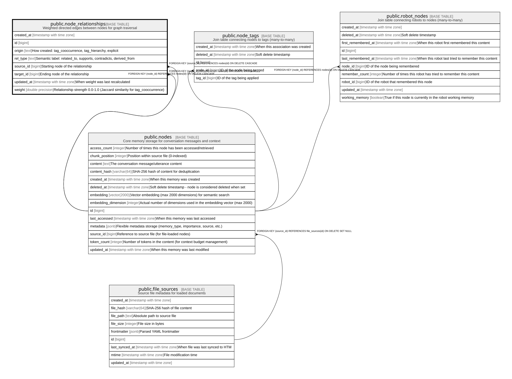

# public.node_relationships

## Description

Weighted directed edges between nodes for graph traversal

## Columns

| Name | Type | Default | Nullable | Children | Parents | Comment |
| ---- | ---- | ------- | -------- | -------- | ------- | ------- |
| created_at | timestamp with time zone | CURRENT_TIMESTAMP | true |  |  |  |
| id | bigint |  | false |  |  |  |
| origin | text | 'tag_cooccurrence'::text | false |  |  | How created: tag_cooccurrence, tag_hierarchy, explicit |
| rel_type | text | 'related_to'::text | false |  |  | Semantic label: related_to, supports, contradicts, derived_from |
| source_id | bigint |  | false |  | [public.nodes](public.nodes.md) | Starting node of the relationship |
| target_id | bigint |  | false |  | [public.nodes](public.nodes.md) | Ending node of the relationship |
| updated_at | timestamp with time zone | CURRENT_TIMESTAMP | true |  |  | When weight was last recalculated |
| weight | double precision | 1.0 | false |  |  | Relationship strength 0.0-1.0 (Jaccard similarity for tag_cooccurrence) |

## Constraints

| Name | Type | Definition |
| ---- | ---- | ---------- |
| chk_node_relationships_no_self_loop | CHECK | CHECK ((source_id <> target_id)) |
| chk_node_relationships_weight | CHECK | CHECK (((weight >= (0.0)::double precision) AND (weight <= (1.0)::double precision))) |
| fk_node_relationships_source | FOREIGN KEY | FOREIGN KEY (source_id) REFERENCES nodes(id) ON DELETE CASCADE |
| fk_node_relationships_target | FOREIGN KEY | FOREIGN KEY (target_id) REFERENCES nodes(id) ON DELETE CASCADE |
| node_relationships_id_not_null | n | NOT NULL id |
| node_relationships_origin_not_null | n | NOT NULL origin |
| node_relationships_pkey | PRIMARY KEY | PRIMARY KEY (id) |
| node_relationships_rel_type_not_null | n | NOT NULL rel_type |
| node_relationships_source_id_not_null | n | NOT NULL source_id |
| node_relationships_target_id_not_null | n | NOT NULL target_id |
| node_relationships_weight_not_null | n | NOT NULL weight |

## Indexes

| Name | Definition |
| ---- | ---------- |
| idx_node_relationships_origin | CREATE INDEX idx_node_relationships_origin ON public.node_relationships USING btree (origin) |
| idx_node_relationships_source_id | CREATE INDEX idx_node_relationships_source_id ON public.node_relationships USING btree (source_id) |
| idx_node_relationships_target_id | CREATE INDEX idx_node_relationships_target_id ON public.node_relationships USING btree (target_id) |
| idx_node_relationships_unique | CREATE UNIQUE INDEX idx_node_relationships_unique ON public.node_relationships USING btree (source_id, target_id, rel_type) |
| idx_node_relationships_weight | CREATE INDEX idx_node_relationships_weight ON public.node_relationships USING btree (weight) |
| node_relationships_pkey | CREATE UNIQUE INDEX node_relationships_pkey ON public.node_relationships USING btree (id) |

## Relations

---

> Generated by [tbls](https://github.com/k1LoW/tbls)
